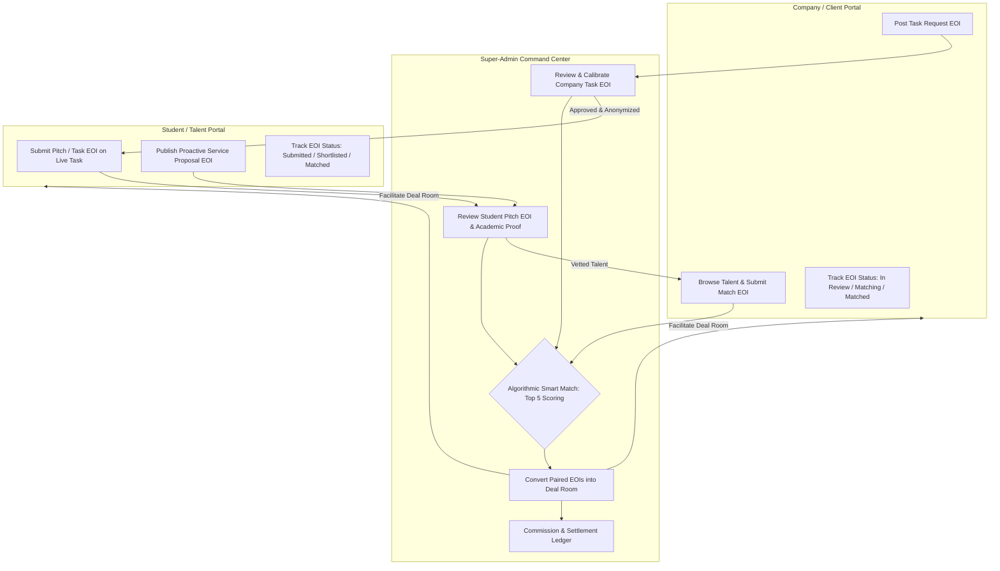

# Figma Prototype — UI/UX Functional Architecture, EOI System & Component Specifications

**Document Version:** 1.1.0  
**Project:** Student Micro-Tasking Hub (Admin-Mediated Concierge Marketplace)  
**File Target:** Figma Interactive Prototype Specification & AI Prompt Import  
**Core Model:** Admin-Mediated Concierge Marketplace with Full Expression of Interest (EOI) Pipeline across Student, Company, and Admin portals.

---

## 1. Prototype Architecture & The EOI (Expression of Interest) Engine

### 1.1 What is an EOI on StudentHub?
The platform operates on an **Expression of Interest (EOI) Concierge Brokerage Architecture** to prevent spam, race-to-the-bottom bidding, and circumvention:
1. **Supply-Side EOI (Student $\rightarrow$ Admin):** 
   - A student reviews an anonymized company task and submits an **EOI / Pitch** to the Admin (stating their technical qualifications, portfolio proof, proposed delivery timeframe, and requested payout).
   - Alternatively, a student publishes a **Proactive Service Proposal EOI** (a pre-packaged deliverable offered to the marketplace).
2. **Demand-Side EOI (Company $\rightarrow$ Admin):** 
   - A company submits a **Task Request EOI** (defining project scope, deliverables, academic requirements, and budget range).
   - Or, a company browses the anonymized student directory and submits a **Talent Match EOI** requesting the Admin to broker an engagement with a specific anonymous profile (`Talent #STU-xxx`).
3. **The Broker Gate (Admin Evaluation & Matchmaking):** 
   - The Super-Admin moderates incoming EOIs, scores student talent against company needs using an algorithmic recommender, calibrates the budget and margin, and converts paired EOIs into an active **Deal Room**.
4. **No Direct Peer-to-Peer Contact & No In-App Payment Gateways:**
   - Both parties stay anonymous until Admin facilitates kickoff in the Deal Room.
   - Invoicing and student disbursements are settled off-platform, tracked manually in the internal Commission Ledger.

---

## 2. EOI Components & Functionalities: Student Page (`/student`)

The Student Portal empowers students to discover opportunities and express interest without being subjected to public bidding wars.

### 2.1 Component: Task Discovery & EOI Trigger (`AnonymizedTaskCard`)
* **Purpose:** Presents sanitized, Admin-approved company micro-tasks for student review.
* **Functional Elements:**
  - **Task Reference Badge:** e.g., `Task #TSK-802`.
  - **Category Pill:** e.g., `Web Development`, `Data Science`, `UI/UX Design`.
  - **Deliverable Objective & Requirements:** Scoped problem statement, required skills chips (`React`, `Python`, `SQL`), and academic level recommendation (`L3 / Master M1`).
  - **Commercial Terms:** Estimated student bounty range (`$250 - $400 USD`), turnaround time (`5 Days`).
  - **EOI Trigger Button (`[View Brief & Express Interest]`):**
    - *On Click:* Opens `ApplyModal` (Task Application / EOI Form) pre-populated with task metadata.

---

### 2.2 Component: Student EOI Application Flow (`ApplyModal`)
* **Trigger:** Clicking `[View Brief & Express Interest]` on any available task.
* **Component Type:** Centered Modal Window with Input Validation.
* **Exact Inputs & Controls:**
  1. **Task Summary Context Header:**
     - Displays Task ID, sanitized title, budget cap, and delivery expectation (read-only).
  2. **Pitch / EOI Statement (Textarea):**
     - Prompt: *"Explain your relevant academic background, coursework, and why you are the best fit for this micro-task."*
     - Validation: Required, minimum 40 characters.
  3. **Turnaround Commitment (Number Input):**
     - Unit: Days. Default populated from task brief (e.g., `5`). Allows the student to commit to a faster or realistic timeline.
  4. **Requested Student Payout (Currency Input):**
     - Pre-filled with standard 80% baseline of the task budget. Student can confirm or adjust within $\pm 15\%$.
  5. **Portfolio & Past Deliverable URLs (Multi-text input):**
     - Add links to GitHub repositories, live Vercel deployments, Behance/Figma files, or Google Drive proof.
  6. **Academic Bandwidth Confirmation Checkbox:**
     - Mandatory toggle: *"I confirm that I have at least 10 hours of weekly availability and that this engagement does not conflict with my university exams."*
* **Interactive Actions:**
  - `[Cancel / Close (X)]`: Aborts EOI without saving.
  - `[Submit EOI to Admin Broker]`:
    - Validates all fields.
    - Creates a new `TaskApplication` (Supply EOI) record in state `SUBMITTED`.
    - Triggers toast alert: *"Your Expression of Interest has been dispatched to Admin Elena for review and matchmaking."*
    - Automatically updates the student's EOI Tracking counter.

---

### 2.3 Component: Proactive Service Proposal Studio (`ProposalModal`)
* **Trigger:** `[+ Create New Service Proposal]` button in student header.
* **Purpose:** Allows students to initiate supply-side EOIs for pre-packaged micro-services (e.g., "3-Day Mobile Wireframe Package" or "Web Scraper Script in Python").
* **Inputs & Controls:**
  1. **Proposal Title:** Text input (e.g., `Automated Web Scraping Script with Clean CSV Export`).
  2. **Specialization Domain:** Dropdown (`Software Engineering`, `Data & Analytics`, `Design & Creative`, `Translation`).
  3. **Scope & Exact Deliverables (Textarea):** Bulleted list of final assets the student will deliver.
  4. **Fixed Proposed Bounty ($ USD):** Number field.
  5. **Delivery Turnaround:** Dropdown (`24h`, `3 Days`, `5 Days`, `7 Days`, `14 Days`).
  6. **Prerequisites Required from Client:** Textarea (e.g., Target URLs, sample CSV schema, brand guidelines).
* **Action:**
  - `[Submit Proposal for Admin Vetting]`: Creates `StudentServiceProposal` in `PENDING_APPROVAL`. Once approved by Admin, it is published to the public talent directory under the student's anonymous handle.

---

### 2.4 Component: Student EOI & Deal Tracking Accordion (`Applications & Deals Tab`)
* **Functional Elements:**
  - Displays real-time status of all submitted EOIs and brokered deals.
  - **EOI Stage Indicators:**
    1. `SUBMITTED`: Under Admin screening.
    2. `UNDER_ADMIN_REVIEW`: Admin is evaluating academic proof & portfolio.
    3. `SHORTLISTED`: Admin has recommended the student to the client.
    4. `MATCHED_TO_DEAL_ROOM`: Client accepted; active engagement room created.
    5. `REJECTED`: Admin feedback provided (e.g., *"Skills mismatch for this specific stack"*).
  - **Interactive Controls:**
    - Expand / Collapse Chevron: Reveals broker notes and submission details.
    - `[Enter Deal Room]` (Enabled only when status is `MATCHED_TO_DEAL_ROOM`): Opens `DealRoomModal`.

---

## 3. EOI Components & Functionalities: Company Page (`/company`)

The Company Portal gives clients two distinct methods to express hiring interest while preserving full scope and budget control.

### 3.1 Component: Client Task Request EOI Wizard (`TaskWizardModal`)
* **Trigger:** Clicking `[+ Post New Micro-Task]` in company navigation.
* **Component Type:** 3-Step Guided Wizard Modal with Progress Indicator.

#### Step 1: Scope & Academic Requirements
* **Inputs & Controls:**
  1. **Task Title:** Single-line text input (e.g., `Build PostgreSQL Database Schema & Migration Scripts`).
  2. **Academic Domain:** Dropdown with 13 categorized majors (e.g., `Engineering, Technology & Computing`, `Finance & Economics`).
  3. **Target Academic Level:** Selector: `Any Level`, `L3`, `Master 1`, `Master 2`, `Engineering Cycle`, `PhD`.
  4. **Problem Statement & Deliverables Description:** Large textarea defining explicit requirements, scope limits, and expected outputs.
* **Action:** `[Next: Technical Specifications ->]` (Validates required fields).

#### Step 2: Technical Specifications & Skills Required
* **Inputs & Controls:**
  1. **Required Skills Tag Input:** Interactive input where pressing Enter adds removable chips (`PostgreSQL`, `Prisma`, `Docker`).
  2. **External Specs / Asset Links:** URL input for Figma links, GitHub repos, or API documentation.
  3. **Target Delivery Timeline (Days):** Integer input (e.g., `7`).
* **Actions:** `[<- Back to Step 1]`, `[Next: Commercials & Budget ->]`.

#### Step 3: Commercials, Budget & Confidentiality Terms
* **Inputs & Controls:**
  1. **Proposed Budget Range ($ USD):** Min and Max budget inputs (e.g., `$350 - $500`).
  2. **Confidentiality / IP Terms:** Options: `Standard Platform Terms`, `Mutual NDA Required`, `Full IP Assignment Upon Payment`.
  3. **Brokerage Acknowledgment Checkbox:** Mandatory checkbox confirming understanding of the concierge matchmaking process.
* **Submission Action:**
  - `[Submit Task Request EOI]`:
    - Dispatches `CompanyTaskRequest` to Admin with status `PENDING_REVIEW`.
    - Generates tracking ID (e.g., `Task #TSK-940`).
    - Appends card to Company's `My Task Requests` queue.

---

### 3.2 Component: Talent Match EOI (`Request Match via Concierge`)
* **Trigger:** Clicking `[Request Match via Concierge]` on any `AnonymizedTalentCard` in the talent directory.
* **Component Type:** Quick EOI Dialog Overlay.
* **Functional Elements:**
  - Selected Candidate Profile: Anonymous Code (e.g., `Talent #STU-104`), Degree, Top Verified Skills, Star Rating.
  - **Associated Task Selector:**
    - Dropdown listing all the company's active task requests: e.g., `[Task #TSK-940: Postgres Migration]`.
    - Option: `[Create New Task for this Talent]`.
  - **Special Scope Notes for Admin (Textarea):** Optional instructions for the broker (e.g., *"We need this talent to start immediately this Thursday"*).
* **Action:**
  - `[Dispatch Match Request to Admin]`:
    - Creates a high-priority match EOI in Admin's CRM.
    - Alerts Admin Elena that Company X specifically requested Candidate Y.

---

### 3.3 Component: Company EOI Management Queue (`My Task Requests Tab`)
* **Functional Elements:**
  - Filterable list of company-submitted EOIs.
  - **Status Badges:**
    - `IN_REVIEW`: Admin is sanitizing scope and confirming market pricing.
    - `ACTIVE_MATCHING`: Admin is running top-5 candidate evaluations.
    - `SHORTLIST_READY`: Admin has selected candidates for client review.
    - `DEAL_ROOM_ACTIVE`: Active engagement underway.
  - **Card Actions:**
    - `[View Matched Candidates]`: Previews anonymous profiles shortlisted by Admin.
    - `[Approve Candidate & Enter Deal Room]`: Confirms selection and enters `DealRoomModal`.

---

## 4. EOI Components & Functionalities: Super-Admin Broker Command Center (`/admin`)

The Super-Admin is the core engine where supply-side and demand-side EOIs intersect, are evaluated, and convert into revenue-generating deals.

### 4.1 Component: Student EOI Applications Queue (`STUDENT_APPLICATIONS Tab`)
* **Purpose:** Centralized moderation desk for all incoming student task applications.
* **Functional Elements:**
  - Application Item Cards:
    1. Student Anonymous Code + Degree (`Talent #STU-312 · M2 Data Science`).
    2. Associated Task Title & Budget (`Task #TSK-904 · $400 USD`).
    3. Application Status Badge (`SUBMITTED`, `SHORTLISTED`, `CONVERTED`).
  - **Expandable Detail View:**
    - Full Student Pitch statement.
    - Verified academic proof status (green shield if ID verified).
    - Relevant portfolio links (clickable external links).
    - Student's proposed delivery days and payout expectation.
  - **Admin EOI Actions:**
    - `[Accept & Shortlist for Client]`: Moves application to `SHORTLISTED`.
    - `[Convert Directly to Deal Room]`: Triggers `SmartMatchModal` with this student pre-selected.
    - `[Reject with Feedback]`: Prompts broker to enter feedback note to the student.

---

### 4.2 Component: Company Task Requests Queue (`COMPANY_REQUESTS Tab`)
* **Purpose:** Moderation desk for incoming company task requests before they are published to students.
* **Functional Elements:**
  - Displays real company identity (unmasked for Admin: Company Name, Contact Person, Email).
  - Scope and problem statement preview.
  - Proposed budget range.
  - **Admin Moderation Actions:**
    1. **Price Calibration:** Admin can adjust budget if client underbid or overbid market rates.
    2. **Sanitize & Anonymize:** Strips any proprietary company PII to protect anti-circumvention.
    3. `[Approve & Publish to Board]`: Makes task visible on the student board in status `APPROVED_ACTIVE`.
    4. `[Run Smart Match Immediately]`: Bypasses public board and matches existing verified talent directly.

---

### 4.3 Component: Algorithmic EOI Matchmaker (`SmartMatchModal`)
* **Trigger:** Clicking `[Smart Match Top 5]` on any approved task in Kanban or Requests queue.
* **Component Type:** High-Density Decision Modal.
* **Algorithmic Evaluation Engine:**
  - Evaluates student pool against task criteria using the weighted formula:
    $$\text{Score} = (w_s \cdot \text{SkillMatch}) + (w_a \cdot \text{AcademicLevelFit}) + (w_r \cdot \text{AdminRating}) + (w_v \cdot \text{Availability})$$
* **Candidate Ranking Display (Top 5):**
  - Score Badge: e.g., `98% Match`.
  - Skill coverage: Matching skills in green, missing in gray.
  - Academic level alignment and availability badge.
  - Selection Radio: Clicking a candidate highlights their card and updates the commercial calibration form.
* **Commercial Calibration & Ledger Setup:**
  - `Agreed Client Budget ($)`: Total billed to company.
  - `Student Payout ($)`: Amount disbursed to student upon completion.
  - `Platform Gross Margin ($)`: Auto-calculated brokerage fee ($ Client Budget - $ Student Payout).
  - `Broker Initiation Notes`: Kickoff guidelines for both parties.
* **Conversion Action:**
  - `[Create Deal & Open Deal Room]`:
    - Converts the matched EOIs into an official `MatchmakingDeal`.
    - Moves Kanban card to `MATCHED_CONNECTED` (Stage 4).
    - Automatically provisions a new entry in `CommissionLedgerTable`.
    - Opens `DealRoomModal`.

---

### 4.4 Component: Concierge Deal Room & Facilitated Handoff (`DealRoomModal`)
* **Trigger:** Accessible by all 3 personas (Admin, Student, Company) once an EOI converts to a deal.
* **Functional Adaptation by Persona:**
  - **Student View:** Sees sanitized company industry, milestone deliverables tracker, deliverable submission field, and chat with Admin.
  - **Company View:** Sees verified student anonymous code, timeline tracker, deliverable review button, and chat with Admin.
  - **Admin View:** Full control — sees both real identities, can post private internal notes, manually advance stages, and approve deliverables.
* **6-Stage Progress Stepper:**
  `1. Matched` $\rightarrow$ `2. Kickoff Scheduled` $\rightarrow$ `3. In Progress` $\rightarrow$ `4. Deliverable Review` $\rightarrow$ `5. Client Approved` $\rightarrow$ `6. Settled`.
* **Deliverable Submission & Sign-off:**
  - Student uploads asset links (GitHub PR, Figma link, archive).
  - Admin verifies quality and marks `[Deliverable Approved]`.
  - Updates ledger entry to `CLIENT_PAID` and schedules student disbursement.

---

### 4.5 Component: Commission & Deal Settlement Ledger (`CommissionLedgerTable`)
* **Target Placement:** Admin `[5. Commission & Deal Ledger]` tab.
* **Functional Elements:**
  - Real-time internal accounting table tracking all active and completed EOI deals.
  - Columns:
    1. Deal Reference (`DL-xxx`).
    2. Task Title & Scope.
    3. Client Name (Real).
    4. Student Identifier (Real Name + Anonymous Code).
    5. Gross Invoice ($).
    6. Student Payout ($).
    7. Platform Brokerage Margin ($).
    8. Invoicing Status (`Pending Invoice` $\rightarrow$ `Invoiced` $\rightarrow$ `Client Paid`).
    9. Disbursement Status (`Pending Completion` $\rightarrow$ `Disbursed to Student`).
  - Total Financial Summary Bar: Gross Transaction Volume, Total Student Earnings, Total Broker Margin.

---

## 5. Screen & Component Architecture Matrix

| Screen Name | Path | Primary Persona | Core Components & EOI Features |
| :--- | :--- | :--- | :--- |
| **Public Landing Page** | `/` | Guest / Public | Dual value propositions, public talent previews, direct portal selector pills, `SignInModal` trigger. |
| **Public Talent Catalog** | `/catalog` | Public / Company | Filterable `AnonymizedTalentCard` grid, search bar, `[Request Match via Concierge]` EOI triggers. |
| **Public Tasks Board** | `/tasks-board` | Public / Student | Filterable `AnonymizedTaskCard` grid, category pills, `[View Brief & Express Interest]` EOI triggers. |
| **Student Portal** | `/student` | Student | Profile header, KPI metrics, `Available Tasks` tab, `My Proposals` studio, `ApplyModal`, `ProposalModal`, EOI tracking accordion. |
| **Company Portal** | `/company` | Company | Active engagements overview, `My Task Requests` queue, `Browse Vetted Talent` tab, `TaskWizardModal` (3-step EOI wizard), `DealRoomModal`. |
| **Admin Command Center**| `/admin` | Super-Admin | `RefADashboardOverview` (KPIs & Charts), `KanbanBoard` (7 stages), `COMPANY_REQUESTS` queue, `STUDENT_APPLICATIONS` queue, `STUDENTS_CRM` (Vetting), `SmartMatchModal`, `CommissionLedgerTable`. |

---

## 6. Prototyping Connections & Interaction Wire Matrix

Configure these exact interactions in Figma to make the prototype fully functional:

| Source Component / Button | Event Trigger | Action | Target Screen / Overlay | Animation & Parameters |
| :--- | :--- | :--- | :--- | :--- |
| **Navbar: Brand Logo** | `On click` | Navigate to | `Landing Page (/)` | Instant / Push |
| **Navbar: [Sign In]** | `On click` | Open overlay | `SignInModal` | Centered, Dissolve 200ms, 40% black overlay |
| **Navbar: Persona Switch (Student)** | `On click` | Navigate to | `Student Portal (/student)` | Smart Animate 250ms Ease-out |
| **Navbar: Persona Switch (Company)** | `On click` | Navigate to | `Company Portal (/company)` | Smart Animate 250ms Ease-out |
| **Navbar: Persona Switch (Admin)** | `On click` | Navigate to | `Admin Dashboard (/admin)` | Smart Animate 250ms Ease-out |
| **Landing: [I am a Student]** | `On click` | Navigate to | `Student Portal (/student)` | Push Left 250ms |
| **Landing: [I am a Company]** | `On click` | Navigate to | `Company Portal (/company)` | Push Left 250ms |
| **Student: [Express Interest]** | `On click` | Open overlay | `ApplyModal (EOI Form)` | Centered, Dissolve 200ms |
| **ApplyModal: [Submit EOI]** | `On click` | Close overlay & Toast | `Student Portal (Toast: EOI Dispatched)` | Dissolve 200ms |
| **Student: [+ Create Proposal]**| `On click` | Open overlay | `ProposalModal` | Centered, Dissolve 200ms |
| **Company: [+ Post Task]** | `On click` | Open overlay | `TaskWizardModal (Step 1)` | Centered, Dissolve 200ms |
| **TaskWizardModal: [Step 1 Next]** | `On click` | Swap overlay | `TaskWizardModal (Step 2)` | Slide In Left 200ms |
| **TaskWizardModal: [Step 2 Next]** | `On click` | Swap overlay | `TaskWizardModal (Step 3)` | Slide In Left 200ms |
| **TaskWizardModal: [Submit EOI]**| `On click` | Close overlay & Toast | `Company Portal (Task Added)` | Dissolve 200ms |
| **Company: [Request Match]** | `On click` | Open overlay | `MatchRequestModal` | Centered, Dissolve 200ms |
| **Admin Kanban: [Smart Match]**| `On click` | Open overlay | `SmartMatchModal` | Centered, Dissolve 200ms |
| **SmartMatchModal: [Create Deal]**| `On click` | Swap overlay | `DealRoomModal` | Dissolve 200ms |
| **Admin CRM: [Vet Profile]** | `On click` | Open overlay | `StudentVettingModal` | Centered, Dissolve 200ms |
| **Any Portal: [Enter Deal Room]**| `On click` | Open overlay | `DealRoomModal` | Centered, Dissolve 200ms |
| **DealRoomModal: [Approve Work]**| `On click` | Set variable | Status to `COMPLETED_COLLECTED` | Smart Animate 200ms |
| **DealRoomModal: [Close (X)]** | `On click` | Close overlay | Parent Dashboard | Dissolve 150ms |

---

## 7. Component State Matrix for Figma Component Sets

| Component Set | Mandatory Variants / States |
| :--- | :--- |
| **`Button/Primary`** | `State=Default`, `Hover`, `Pressed`, `Disabled`, `Loading (Spinner)` |
| **`InputField/Text`** | `State=Empty`, `Filled`, `Focused (Active Ring)`, `Error (Red Message)`, `Disabled` |
| **`AnonymizedTalentCard`** | `ViewMode=Public_Catalog`, `ViewMode=Admin_CRM`, `Hover=True/False` |
| **`AnonymizedTaskCard`** | `Status=Live_Open`, `Status=Matching`, `Status=Completed`, `Hover=True/False` |
| **`EOI_ApplicationCard`** | `Status=Submitted`, `Status=UnderReview`, `Status=Shortlisted`, `Status=Converted`, `Expanded=True/False` |
| **`KanbanCard/Deal`** | `Stage=InReview`, `Stage=Matching`, `Stage=Shortlisted`, `Stage=DealRoom`, `Stage=Completed` |
| **`DealRoom/Facilitator`**| `RoleView=Student`, `RoleView=Company`, `RoleView=Admin`, `Stage=Step1..Step6` |
| **`StatusBadge/Ledger`** | `Invoice=Pending`, `Invoice=Sent`, `Invoice=Paid`, `Payout=Pending`, `Payout=Disbursed` |

---

## 8. Master Prompt for Figma AI / Importers

> "Design a multi-role interactive prototype for an Admin-Mediated Concierge Student Micro-Tasking Marketplace ('Student Hub'). The design must incorporate an end-to-end Expression of Interest (EOI) architecture across three dedicated portals: Student, Company, and Super-Admin. Key components include: 
> 1) Student Portal: Anonymized task feed with task EOI application modal (pitch statement, turnaround commitment, rate negotiation, portfolio links) and proactive service proposal studio.
> 2) Company Portal: Multi-step task request EOI wizard (scope, academic level, technical stack, budget range, confidentiality terms), talent directory with 'Request Match' concierge EOI triggers, and EOI request status tracking.
> 3) Super-Admin Command Center: Inbound student EOI applications queue, company task EOI moderation desk with price calibration, algorithmic top-5 matching evaluation modal, student credential vetting modal with document inspector, facilitated multi-stage Deal Room with milestone deliverable approval, and an internal commission settlement ledger table.
> Ensure all screens adhere strictly to the Privacy Shield doctrine (anonymized student handles #STU-xxx and sanitized company industry tags) and include interactive states for hover, focused inputs, step transitions, and modal overlays."
