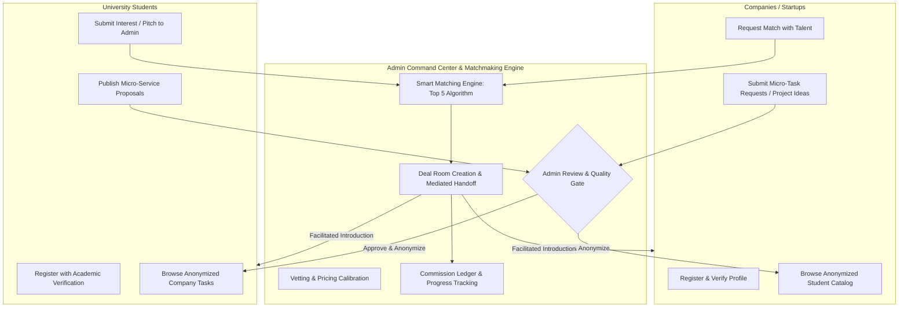
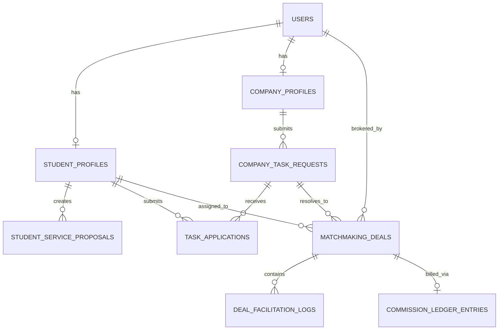
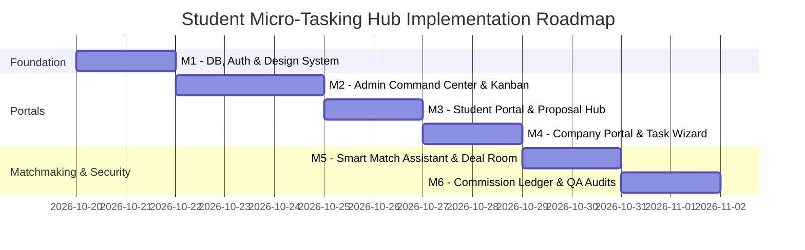

# Product Requirements Document (PRD)
## Project: Student Micro-Tasking Hub (Admin-Mediated Concierge Marketplace)

**Document Version:** 1.0.0  
**Status:** Under Architectural Review  
**Author:** Elite Product Architect & Senior Full-Stack Systems Engineer  
**Date:** October 19, 2026  

---

## 1. Executive Summary & Concierge Brokerage Logic

### 1.1 Product Vision
The **Student Micro-Tasking Hub** is a curated, high-trust talent and micro-task brokerage platform designed to bridge the gap between **University Students** seeking paid, portfolio-building experience and **Companies / Startups** needing cost-effective, agile execution for discrete micro-tasks.

Unlike open, unvetted marketplaces (such as Upwork, Fiverr, or Freelancer) where race-to-the-bottom bidding and spam proposals erode trust, this platform operates on an **Admin-Mediated Concierge Brokerage Model**. The Platform Owner (Admin) functions as an active broker, matchmaker, and quality-assurance gatekeeper.



### 1.2 Target Personas

| Persona | Description | Primary Value Drivers | Key Sensitivities |
| :--- | :--- | :--- | :--- |
| **University Student (Supply)** | Enrolled undergraduate or graduate students (L1–L3, M1–M2, Engineering/PhD) with proven skills in software, design, marketing, data, writing, or translation. | Fair compensation, flexible hours, verified portfolio additions, direct access to startups without bidding wars. | Academic workload conflicts, fear of non-payment or exploitative scope creep. |
| **Company / Startup (Demand)** | Early-stage founders, SMEs, agency leads, and project managers requiring targeted assistance on well-scoped tasks (e.g., landing page, bug fix, scraping script, deck polish). | Pre-vetted student talent, rapid turnaround, cost efficiency compared to full agencies, no administrative hiring overhead. | Quality inconsistency, missed deadlines, confidentiality/IP security. |
| **Super-Admin (Broker)** | Platform owner / venture operator who curates both supply and demand, negotiates scopes, facilitates introductions, and monitors deliverables. | High matchmaking success rate, recurring client retention, concierge brokerage margin (15%–25%). | Circumvention risk (parties trading contacts offline), manual bottleneck without automated matching tools. |

### 1.3 The Concierge Brokerage Model & Financial Flow
1. **Zero Automated In-App Payment Gateways:**
   * In strict alignment with operational requirements, the software does **NOT** embed Stripe, PayPal, credit card gateways, or complex escrow crypto/fiat wallets.
   * Eliminates PCI-DSS compliance overhead, chargeback fraud, and payment gateway transaction fees.
2. **Off-Platform Settlement with Internal Ledger Tracking:**
   * **Client Invoicing:** Upon matching approval, the Admin sends an official B2B invoice (via corporate email/Stripe billing link/bank transfer outside the app).
   * **Student Disbursement:** Upon verified task completion, the Admin releases payment to the student's designated bank account / IBAN / mobile payment off-platform.
   * **Internal Ledger:** The platform software includes an internal **Commission & Deal Ledger** for recording agreed project budget, student payout, platform gross margin, invoice reference IDs, and payment statuses (`Pending Invoice`, `Invoiced`, `Client Paid`, `Disbursed to Student`).

### 1.4 The Privacy Shield & Anti-Circumvention Doctrine
To prevent platform bypass (disintermediation):
* **Strict Public Anonymity:** 
  * Unmatched students are identified solely by pseudo-anonymous handles (e.g., `Talent #STU-482`, Major: `M2 Software Engineering - ENSIAS`, Verified Skills: `[React, Python, Tailwind]`, Internal Rating: `4.9/5.0`). No email, phone, full name, or personal social links are exposed.
  * Task listings display only company industry, company size category, project scope, technical requirements, and estimated bounty. Exact company name, website, and executive contacts remain hidden.
* **Server-Side Data Masking:** API endpoints serving catalog views strictly filter and project only non-identifying fields at the database query level. PII is never included in API payloads, preventing client-side network inspection exploitation.
* **Controlled Handoff:** Contact information is revealed or facilitated only when a `MatchmakingDeal` reaches the `Matched / Connected` state under explicit Admin authorization.

---

## 2. User Journeys & UI/UX Wireframe Specifications

### 2.1 Public Landing Page (Dual-Value Proposition)

```
+-----------------------------------------------------------------------------------------+
| [Logo] StudentHub          How It Works    For Students    For Companies    [Sign In]  |
+-----------------------------------------------------------------------------------------+
|                                                                                         |
|       Elite Student Talent. Curated Micro-Tasks. Zero Bidding Friction.                 |
|       We manually connect ambitious university talent with vetted startups and SMEs.     |
|                                                                                         |
|      [ I am a Student: Join & Earn ]           [ I am a Company: Hire Talent ]          |
|                                                                                         |
+-----------------------------------------------------------------------------------------+
| [Value Proposition 1: Companies]              | [Value Proposition 2: Students]         |
| - Pre-vetted academic rigor (L2-M2)           | - Fair, guaranteed compensation         |
| - Managed concierge oversight                 | - Real-world portfolio & startup credit |
| - Scoped micro-tasks (24h to 14 days)         | - No public bidding wars                |
+-----------------------------------------------------------------------------------------+
|                                                                                         |
| HOW THE CONCIERGE MODEL WORKS:                                                          |
| [1. Post Task / Proposal] -> [2. Admin Vets & Matches] -> [3. Curated Handoff & Done]   |
|                                                                                         |
+-----------------------------------------------------------------------------------------+
| LIVE TALENT PREVIEW (Anonymized)              | ACTIVE MICRO-TASKS PREVIEW (Anonymized) |
| * Talent #STU-104 | M2 Data Science | NLP/SQL | * Fintech SaaS | Build CSV Importer     |
| * Talent #STU-219 | L3 UI/UX Design | Figma   | * HealthTech | Mobile Flow Prototypes   |
+-----------------------------------------------------------------------------------------+
```

### 2.2 Student Portal Dashboard

#### Navigation Tabs
1. **My Profile & Verification:** Academic details, portfolio, verification badge status.
2. **My Service Proposals:** Creator studio for student-initiated micro-service offerings.
3. **Available Micro-Tasks:** Live board of Admin-approved company tasks with pitch modal.
4. **Active Deals & Applications:** Real-time tracking of applications and Admin-brokered engagements.

#### UI Wireframe: Student Task Application & Tracking
```
+-----------------------------------------------------------------------------------------+
| [Student Portal]  Dashboard   My Proposals (3)   Browse Tasks   Applications (2)   [User] |
+-----------------------------------------------------------------------------------------+
| AVAILABLE TASKS (Anonymized by Admin)                       Filter: [Engineering v] [M1+]|
| +-------------------------------------------------------------------------------------+ |
| | Task #TSK-802: Full-Stack Next.js Landing Page with Dynamic Waitlist Form           | |
| | Category: Web Development | Level: L3 / M1 | Timeline: 5 Days | Est. Bounty: $250     | |
| | Requirements: React, Tailwind CSS, Supabase / PostgreSQL                            | |
| | [ View Brief & Apply to Admin ]                                                     | |
| +-------------------------------------------------------------------------------------+ |
|                                                                                         |
| MY ACTIVE APPLICATIONS & BROKERED DEALS                                                 |
| +-------------------------------------------------------------------------------------+ |
| | Task Ref   | Title                     | Status                | Admin Note         | |
| | TSK-802    | Next.js Landing Page      | SHORTLISTED           | "Interview sched." | |
| | TSK-741    | Python Scraper for E-Com  | IN PROGRESS (MATCHED) | "Kickoff call sent"| |
| +-------------------------------------------------------------------------------------+ |
```

#### Student Profile Builder Fields
* **Personal & Contact (Private to Admin):** Full Name, University Email (`.edu` / institutional), WhatsApp/Phone, City/Country.
* **Academic Credentials:** University/Grande École, Faculty/Department, Degree Level (`L1`, `L2`, `L3`, `M1`, `M2`, `Engineering Degree`, `PhD`), Expected Graduation Year.
* **Verification Proof:** Student ID Card scan / Certificate of Enrollment upload (stored in private S3/Storage bucket accessible only to Admin).
* **Skill Vector & Portfolio:** Primary Domain, Tagged Skills (e.g., `TypeScript`, `Figma`, `Financial Modeling`), GitHub URL, Behance/Figma URL, LinkedIn, Personal Website.
* **Availability:** Hours available per week (`5-10h`, `10-20h`, `20h+`), Immediate Start (`Yes/No`).

### 2.3 Company / Startup Portal Dashboard

#### Navigation Tabs
1. **Submit New Task / Project Idea:** Multi-step wizard to define scope and budget.
2. **My Task Requests:** Tracking active submissions and matching statuses.
3. **Vetted Student Catalog:** Searchable anonymized student directory with "Request Match" action.
4. **Active Matches / Deal Room:** Direct mediated updates from the Admin.

#### UI Wireframe: Company "Submit a Task" Wizard
```
+-----------------------------------------------------------------------------------------+
| [Company Portal]  My Requests (4)   Submit Task   Browse Talent   Deal Rooms   [Company]|
+-----------------------------------------------------------------------------------------+
| SUBMIT A MICRO-TASK OR PROJECT IDEA (Step 1 of 3: Scope & Objectives)                   |
|                                                                                         |
| Task Title: [ E.g., Implement Responsive Customer Analytics Dashboard                ] |
| Category:   [ Data Visualization & Frontend Development                             v ] |
| Target Academic Level: [x] Any  [x] Master (M1/M2)  [ ] Engineering Cycle               |
|                                                                                         |
| Problem Statement & Specific Deliverables:                                              |
| +-------------------------------------------------------------------------------------+ |
| | We need a clean dashboard using Tremor/Recharts in Next.js to visualize 4 KPI charts| |
| | and export CSV reports. Mock data and Figma designs are ready.                       | |
| +-------------------------------------------------------------------------------------+ |
| Required Skills: [ React x ] [ TypeScript x ] [ Tailwind CSS x ] [ Recharts x ]         |
| Target Delivery Timeline: [ 7 Days ]     Proposed Budget Range (USD): [ $300 - $450   ] |
|                                                                                         |
| [ Cancel ]                                                  [ Next: Attach Specs -> ]   |
+-----------------------------------------------------------------------------------------+
```

### 2.4 Super-Admin Command Center & Brokerage Engine

The Super-Admin portal is the core engine of the business model.

#### Modules:
1. **Kanban Brokerage Board (Matchmaking Pipeline):**
   * Columns: `1. In Review (Submissions)` $\rightarrow$ `2. Approved & Matching` $\rightarrow$ `3. Shortlisted` $\rightarrow$ `4. Matched / Connected` $\rightarrow$ `5. In Progress` $\rightarrow$ `6. Completed & Billed` $\rightarrow$ `7. Archived/Rejected`.
2. **Smart Matching Assistant (Algorithmic Recommender):**
   * Automatically calculates similarity scores between `CompanyTaskRequest` requirements and `StudentProfile` attributes.
   * Ranks the top 5 students based on:
     $$\text{Score} = (w_s \cdot \text{SkillMatch}) + (w_a \cdot \text{AcademicLevelFit}) + (w_r \cdot \text{AdminRating}) + (w_v \cdot \text{Availability})$$
   * Displays instant "One-Click Match" action for Admin.
3. **Student Talent CRM & Vetting Center:**
   * Review student verification documents, assign internal reliability ratings (1.0–5.0), add private internal notes, and approve/reject profiles.
4. **Company Account CRM:**
   * Review submitted company tasks, adjust proposed budget to realistic market tiers, and approve for anonymized display.
5. **The Deal Room & Facilitated Handoff Center:**
   * Manages formal introduction email templates, kickoff schedule logs, and milestone deliverables verification.
6. **Manual Commission & Settlement Ledger:**
   * Financial tracking table (Gross Value, Student Cost, Platform Commission, Invoicing Status, Disbursement Status).

```
+------------------------------------------------------------------------------------------------------------------------------------+
| [SUPER-ADMIN COMMAND CENTER]     Deals Pipeline | Talent CRM | Company CRM | Proposals Queue | Financial Ledger | [Admin: Online]  |
+------------------------------------------------------------------------------------------------------------------------------------+
| SMART MATCHING ASSISTANT: Company Task #TSK-904 ("Fintech CSV Pipeline in Python") - Target: $400                                 |
| Top Recommended Candidates:                                                                                                        |
| 1. Candidate #STU-312 (M2 Computer Science - 98% Match) - Skills: Python, Pandas, FastAPI | Rating: 5.0 | Avail: 15h/w [Select Match] |
| 2. Candidate #STU-108 (M1 Data Engineering - 91% Match) - Skills: Python, SQL, ETL        | Rating: 4.8 | Avail: 10h/w [Select Match] |
| 3. Candidate #STU-455 (L3 Software Eng - 84% Match)    - Skills: Python, Flask            | Rating: 4.6 | Avail: 20h/w [Select Match] |
+------------------------------------------------------------------------------------------------------------------------------------+
| KANBAN BROKERAGE PIPELINE:                                                                                                         |
| [1. In Review]      | [2. Matching]         | [3. Shortlisted]      | [4. Matched]         | [5. In Progress]    | [6. Completed]       |
| * TSK-908 (Mobile)  | * TSK-904 (Python)    | * TSK-899 (SEO Audit) | * TSK-881 (React UI) | * TSK-870 (Scraper) | * TSK-860 (Brand Kit)|
|   Company: Alpha    |   Matched: STU-312    |   Pitch by STU-204    |   Student: STU-112   |   Student: STU-094  |   Commission: $75    |
|   Value: $200       |   Value: $400         |   Value: $150         |   Deal: #DL-402      |   Due: In 2 days    |   Status: Invoiced   |
+------------------------------------------------------------------------------------------------------------------------------------+
```

---

## 3. Database Schema & Architecture

The architecture utilizes a relational SQL database with high integrity constraints, role-based relations, and indexing tailored for multi-attribute matching and privacy preservation.



### 3.1 Comprehensive Prisma Schema Specification

```prisma
datasource db {
  provider = "postgresql"
  url      = env("DATABASE_URL")
}

generator client {
  provider = "prisma-client-js"
}

// -------------------------------------------------------------
// ENUMS
// -------------------------------------------------------------

enum UserRole {
  STUDENT
  COMPANY
  SUPER_ADMIN
}

enum VerificationStatus {
  UNVERIFIED
  PENDING_REVIEW
  VERIFIED
  REJECTED
}

enum AcademicLevel {
  LICENCE_1
  LICENCE_2
  LICENCE_3
  MASTER_1
  MASTER_2
  ENGINEERING_CYCLE
  PHD_DOCTORATE
  OTHER
}

enum ProposalApprovalStatus {
  DRAFT
  PENDING_APPROVAL
  APPROVED_LIVE
  REJECTED
  ARCHIVED
}

enum TaskRequestStatus {
  DRAFT
  PENDING_REVIEW
  APPROVED_ACTIVE
  MATCHING_IN_PROGRESS
  ALLOCATED_IN_PROGRESS
  COMPLETED
  CANCELLED
}

enum ApplicationStatus {
  SUBMITTED
  REVIEWED_BY_ADMIN
  SHORTLISTED
  REJECTED
  CONVERTED_TO_DEAL
}

enum DealStatus {
  SUBMITTED
  UNDER_ADMIN_REVIEW
  SHORTLISTED
  MATCHED_CONNECTED
  IN_PROGRESS
  DELIVERABLE_SUBMITTED
  COMPLETED_COMMISSION_COLLECTED
  DISPUTED
  CANCELLED
}

enum CommissionPaymentStatus {
  PENDING_INVOICE
  INVOICED
  CLIENT_PAID
  STUDENT_DISBURSED
  FULLY_SETTLED
}

// -------------------------------------------------------------
// USER & CORE AUTH
// -------------------------------------------------------------

model User {
  id             String    @id @default(cuid())
  email          String    @unique
  hashedPassword String
  role           UserRole  @default(STUDENT)
  isActive       Boolean   @default(true)
  createdAt      DateTime  @default(now())
  updatedAt      DateTime  @updatedAt

  // Profile Relations
  studentProfile StudentProfile?
  companyProfile CompanyProfile?

  // Admin Relations
  brokeredDeals        MatchmakingDeal[]        @relation("AdminBroker")
  facilitationLogsSent DealFacilitationLog[]    @relation("MessageSender")

  @@index([email, role])
}

// -------------------------------------------------------------
// STUDENT PROFILE
// -------------------------------------------------------------

model StudentProfile {
  id                 String             @id @default(cuid())
  userId             String             @unique
  user               User               @relation(fields: [userId], references: [id], onDelete: Cascade)
  
  // Public/Anonymized Handle
  anonymousCode      String             @unique // E.g., "STU-9402"
  
  // Real Identity (Strictly masked from companies)
  fullName           String
  phone              String?
  universityEmail    String?
  
  // Academic Attributes
  university         String
  facultyOrSchool    String?
  major              String             // E.g., "Software Engineering", "Finance"
  academicLevel      AcademicLevel      @default(LICENCE_3)
  graduationYear     Int?
  studentIdDocUrl    String?            // Link to stored verification document
  verificationStatus VerificationStatus @default(PENDING_REVIEW)
  
  // Competencies & Portfolio
  bioSummary         String?            @db.Text
  skills             String[]           // Array of tags: ["React", "FastAPI", "SQL"]
  portfolioLinks     String[]           // Links: GitHub, Behance, LinkedIn (Sanitized in public views)
  weeklyAvailability Int                @default(10) // Hours per week
  
  // Internal Admin Quality Metrics
  internalAdminRating Float              @default(5.0) // 1.00 to 5.00
  adminNotes          String?            @db.Text
  
  createdAt          DateTime           @default(now())
  updatedAt          DateTime           @updatedAt

  // Relationships
  serviceProposals   StudentServiceProposal[]
  applications       TaskApplication[]
  dealsAssigned      MatchmakingDeal[]

  @@index([verificationStatus, academicLevel])
  @@index([skills])
}

// -------------------------------------------------------------
// COMPANY PROFILE
// -------------------------------------------------------------

model CompanyProfile {
  id                 String             @id @default(cuid())
  userId             String             @unique
  user               User               @relation(fields: [userId], references: [id], onDelete: Cascade)
  
  // Public/Anonymized Handle
  anonymousCode      String             @unique // E.g., "CMP-1284"
  
  // Identity & Private Details (Masked from students)
  companyName        String
  contactPersonName  String
  contactPersonTitle String?
  contactPhone       String?
  corporateWebsite   String?
  
  // Business Attributes
  industry           String             // E.g., "Fintech", "HealthTech", "E-commerce"
  companySize        String?            // E.g., "1-10", "11-50", "51-200"
  verificationStatus VerificationStatus @default(PENDING_REVIEW)
  adminNotes         String?            @db.Text
  
  createdAt          DateTime           @default(now())
  updatedAt          DateTime           @updatedAt

  // Relationships
  taskRequests       CompanyTaskRequest[]

  @@index([industry, verificationStatus])
}

// -------------------------------------------------------------
// STUDENT SERVICE PROPOSALS (Supply Side)
// -------------------------------------------------------------

model StudentServiceProposal {
  id                  String                 @id @default(cuid())
  studentProfileId    String
  studentProfile      StudentProfile         @relation(fields: [studentProfileId], references: [id], onDelete: Cascade)
  
  title               String                 // E.g., "Build a responsive Next.js landing page"
  category            String                 // E.g., "Web Development", "UI/UX", "Data Engineering"
  description         String                 @db.Text
  deliverablesSummary String                 @db.Text
  turnaroundDays      Int                    @default(3)
  proposedStudentFee  Decimal                @db.Decimal(10, 2) // What student expects to earn
  
  approvalStatus      ProposalApprovalStatus @default(PENDING_APPROVAL)
  isLiveInCatalog     Boolean                @default(false)
  adminFeedback       String?                @db.Text
  
  createdAt           DateTime               @default(now())
  updatedAt           DateTime               @updatedAt

  @@index([approvalStatus, isLiveInCatalog, category])
}

// -------------------------------------------------------------
// COMPANY TASK REQUESTS (Demand Side)
// -------------------------------------------------------------

model CompanyTaskRequest {
  id                   String            @id @default(cuid())
  companyProfileId     String
  companyProfile       CompanyProfile    @relation(fields: [companyProfileId], references: [id], onDelete: Cascade)
  
  referenceCode        String            @unique // E.g., "TSK-7840"
  title                String
  category             String
  problemStatement     String            @db.Text
  deliverablesCriteria String            @db.Text
  requiredSkills       String[]
  targetAcademicLevel  AcademicLevel?
  estimatedDurationDays Int              @default(7)
  proposedBudget       Decimal           @db.Decimal(10, 2)
  
  status               TaskRequestStatus @default(PENDING_REVIEW)
  isPubliclyVisible    Boolean           @default(false) // Whether visible in anonymized student board
  adminCuratedNotes    String?           @db.Text
  
  createdAt            DateTime          @default(now())
  updatedAt            DateTime          @updatedAt

  // Relationships
  applications         TaskApplication[]
  deals                MatchmakingDeal[]

  @@index([status, isPubliclyVisible, category])
}

// -------------------------------------------------------------
// TASK APPLICATIONS (Student Expressing Interest to Admin)
// -------------------------------------------------------------

model TaskApplication {
  id                   String             @id @default(cuid())
  taskRequestId        String
  taskRequest          CompanyTaskRequest @relation(fields: [taskRequestId], references: [id], onDelete: Cascade)
  studentProfileId     String
  studentProfile       StudentProfile     @relation(fields: [studentProfileId], references: [id], onDelete: Cascade)
  
  pitchStatement       String             @db.Text // Tailored pitch to Admin
  relevantPortfolioUrls String[]
  availabilityConfirmed Boolean           @default(true)
  status               ApplicationStatus  @default(SUBMITTED)
  adminReviewScore     Int?               // 1-10
  adminNotes           String?            @db.Text
  
  createdAt            DateTime           @default(now())
  updatedAt            DateTime           @updatedAt

  @@unique([taskRequestId, studentProfileId])
  @@index([status])
}

// -------------------------------------------------------------
// MATCHMAKING DEALS (Core Brokerage Engine Table)
// -------------------------------------------------------------

model MatchmakingDeal {
  id                     String            @id @default(cuid())
  dealReference          String            @unique // E.g., "DL-2026-0042"
  
  taskRequestId          String
  taskRequest            CompanyTaskRequest @relation(fields: [taskRequestId], references: [id], onDelete: Restrict)
  
  studentProfileId       String
  studentProfile         StudentProfile    @relation(fields: [studentProfileId], references: [id], onDelete: Restrict)
  
  brokeredByAdminId      String
  brokeredByAdmin        User              @relation("AdminBroker", fields: [brokeredByAdminId], references: [id])
  
  // Pipeline State
  status                 DealStatus        @default(SUBMITTED)
  
  // Financial Values (Off-platform contract parameters)
  agreedClientBudget     Decimal           @db.Decimal(10, 2)
  agreedStudentPayout    Decimal           @db.Decimal(10, 2)
  platformGrossMargin    Decimal           @db.Decimal(10, 2) // clientBudget - studentPayout
  
  // Deadlines & Milestones
  kickoffDate            DateTime?
  agreedDeadlineDate     DateTime?
  actualDeliveredDate    DateTime?
  
  adminSummaryNotes      String?           @db.Text
  createdAt              DateTime          @default(now())
  updatedAt              DateTime          @updatedAt

  // Sub-records
  facilitationLogs       DealFacilitationLog[]
  commissionLedgerEntry  CommissionLedgerEntry?

  @@index([status, brokeredByAdminId])
}

// -------------------------------------------------------------
// FACILITATION LOGS / ADMIN-MODERATED TICKET THREAD
// -------------------------------------------------------------

model DealFacilitationLog {
  id             String          @id @default(cuid())
  dealId         String
  deal           MatchmakingDeal @relation(fields: [dealId], references: [id], onDelete: Cascade)
  
  senderId       String
  sender         User            @relation("MessageSender", fields: [senderId], references: [id])
  
  messageContent String          @db.Text
  isInternalNote Boolean         @default(false) // If true, only visible to Admins
  fileAttachment String?
  
  createdAt      DateTime        @default(now())

  @@index([dealId, isInternalNote])
}

// -------------------------------------------------------------
// COMMISSION LEDGER (Manual Off-Platform Record Keeping)
// -------------------------------------------------------------

model CommissionLedgerEntry {
  id                    String                  @id @default(cuid())
  dealId                String                  @unique
  deal                  MatchmakingDeal         @relation(fields: [dealId], references: [id], onDelete: Cascade)
  
  invoiceReferenceNumber String?                // E.g., "INV-2026-881"
  invoiceSentDate        DateTime?
  invoiceDueDate         DateTime?
  paymentReceivedDate    DateTime?
  
  studentDisbursedDate   DateTime?
  disbursementReference  String?                // E.g., "WIRE-REF-992144"
  
  status                 CommissionPaymentStatus @default(PENDING_INVOICE)
  settlementNotes        String?                 @db.Text
  
  createdAt              DateTime                @default(now())
  updatedAt              DateTime                @updatedAt

  @@index([status])
}
```

---

## 4. Technical Stack, Security Rules & API Blueprint

### 4.1 Recommended Production Architecture & Technology Stack

| Layer | Selected Technology | Architecture Rationale |
| :--- | :--- | :--- |
| **Framework** | **Next.js 14+ (App Router)** | Full-stack TypeScript architecture, React Server Components for optimal data isolation, and built-in Server Actions for secure transactional mutations. |
| **Styling & UI** | **Vanilla CSS + Tailwind CSS + Lucide Icons + Radix UI** | Responsive, high-conversion visual design with fluid micro-interactions, dark/light theme, and strict layout consistency. |
| **Database & ORM**| **PostgreSQL + Prisma ORM** | ACID compliant relational storage for multi-table brokerage logic, strong typing, and schema migration integrity. |
| **Authentication**| **NextAuth.js (Auth.js v5) / JWT RBAC** | Role-Based Access Control (`STUDENT`, `COMPANY`, `SUPER_ADMIN`) with secure session cookies and middleware-level route protection. |
| **Form Validation**| **Zod + React Hook Form** | Dual-tier schema validation (client-side interactive feedback and server-side strict assertion). |
| **File Storage** | **Cloudflare R2 / AWS S3 (Presigned URLs)** | Secure, isolated document storage for student identity proofs and project briefs, with non-public signed URLs. |

### 4.2 Clean Directory & Modular File Structure

```
student-microtasking-hub/
├── .env.example
├── PRD.md                           # Master Architecture Document
├── package.json
├── tsconfig.json
├── prisma/
│   ├── schema.prisma                # Relational Model & Enums
│   └── seed.ts                      # Demo seed (Admins, Vetted Students, Startups, Tasks)
├── src/
│   ├── app/
│   │   ├── (auth)/
│   │   │   ├── login/page.tsx
│   │   │   └── register/page.tsx
│   │   ├── (public)/
│   │   │   ├── page.tsx             # Dual-sided high-conversion landing page
│   │   │   ├── talent/page.tsx      # Anonymized Student Catalog
│   │   │   └── tasks/page.tsx       # Anonymized Micro-Tasks Board
│   │   ├── (dashboard)/
│   │   │   ├── student/
│   │   │   │   ├── page.tsx         # Student Overview & Verification Status
│   │   │   │   ├── proposals/page.tsx # Micro-Service Proposal Studio
│   │   │   │   ├── tasks/page.tsx   # Browse & Apply with Pitch
│   │   │   │   └── deals/page.tsx   # Active Brokered Deals & Submissions
│   │   │   ├── company/
│   │   │   │   ├── page.tsx         # Company Overview
│   │   │   │   ├── submit/page.tsx  # Multi-step Task Creation Wizard
│   │   │   │   ├── requests/page.tsx# Task Status Tracker
│   │   │   │   └── talent/page.tsx  # Vetted Talent Catalog + Match Request
│   │   │   └── admin/
│   │   │       ├── page.tsx         # Executive Overview & Stats
│   │   │       ├── kanban/page.tsx  # Interactive Matchmaking Pipeline Board
│   │   │       ├── matching/page.tsx# Smart Matching Assistant (Top 5 Finder)
│   │   │       ├── students/page.tsx# Talent Directory & Verification Queue
│   │   │       ├── companies/page.tsx# Company Lead CRM
│   │   │       └── ledger/page.tsx  # Manual Commission & Payment Ledger
│   │   └── api/
│   │       └── auth/[...nextauth]/route.ts
│   ├── components/
│   │   ├── ui/                      # Buttons, Modals, Badges, Tables, Inputs
│   │   ├── layout/                  # Navbar, Sidebar, Footer, Breadcrumbs
│   │   ├── landing/                 # Hero, ValueProps, DualCards, LiveTicker
│   │   ├── admin/                   # KanbanCard, MatchRecommender, LedgerModal
│   │   └── shared/                  # AnonymizedTalentCard, AnonymizedTaskCard
│   ├── lib/
│   │   ├── auth.ts                  # NextAuth options & session helpers
│   │   ├── db.ts                    # Prisma singleton instance
│   │   ├── matching-engine.ts       # Top 5 algorithmic scoring implementation
│   │   ├── privacy-shield.ts        # Server-side PII sanitization & DTO projection
│   │   └── utils.ts
│   └── types/
│       └── index.ts                 # DTOs, API contracts, session interfaces
```

### 4.3 Strict Data-Masking & Privacy Shield Security Rules

#### Rule 1: Zero-Leak Data Transfer Objects (DTO Projection)
Raw database records are **never** returned directly to non-admin client components. The application enforces server-side DTO sanitization via `privacy-shield.ts`.

```typescript
// Sample Privacy Shield DTO Projections

export interface AnonymizedStudentDTO {
  anonymousCode: string;          // E.g., "STU-9402"
  major: string;                  // E.g., "M2 Computer Science"
  university: string;             // E.g., "Sorbonne University"
  academicLevel: string;          // E.g., "MASTER_2"
  skills: string[];               // E.g., ["React", "FastAPI"]
  weeklyAvailability: number;     // E.g., 15
  internalAdminRating: number;    // E.g., 4.9
  // OMITTED: fullName, phone, universityEmail, studentIdDocUrl, adminNotes
}

export interface AnonymizedTaskDTO {
  referenceCode: string;          // E.g., "TSK-7840"
  title: string;
  category: string;
  problemStatement: string;
  deliverablesCriteria: string;
  requiredSkills: string[];
  estimatedDurationDays: number;
  proposedBudget: number;
  industryCategory: string;       // E.g., "Fintech"
  // OMITTED: companyName, contactPersonName, contactPhone, corporateWebsite
}
```

#### Rule 2: Server-Side Field Redaction in Database Queries
Prisma queries invoked on behalf of students or companies explicitly declare `select` fields, preventing PII from ever entering the Node.js memory buffer during public/catalog queries:

```typescript
// Public Student Catalog Query: PII NEVER fetched from DB
const publicStudents = await prisma.studentProfile.findMany({
  where: { verificationStatus: 'VERIFIED' },
  select: {
    anonymousCode: true,
    major: true,
    university: true,
    academicLevel: true,
    skills: true,
    weeklyAvailability: true,
    internalAdminRating: true,
    // fullName, phone, email NOT selected
  }
});
```

#### Rule 3: RBAC Route Enforcement Middleware
* `/admin/*`: Accessible only to sessions with `role === "SUPER_ADMIN"`.
* `/student/*`: Accessible only to sessions with `role === "STUDENT"`.
* `/company/*`: Accessible only to sessions with `role === "COMPANY"`.
* Any unauthorized access triggers an immediate 307 redirect to `/login` with an audit security log.

### 4.4 API & Server Actions Blueprint

#### 1. Public & Core Actions
* `authenticateUser(credentials)`: Logs user in, verifies bcrypt hash, returns role-aware JWT.
* `registerStudent(studentData)`: Creates `User` and initial `StudentProfile` with `PENDING_REVIEW`.
* `registerCompany(companyData)`: Creates `User` and initial `CompanyProfile`.
* `getAnonymizedTalentCatalog(filters)`: Returns sanitized student proposals/profiles.
* `getAnonymizedTaskBoard(filters)`: Returns sanitized company micro-tasks.

#### 2. Student Actions
* `submitServiceProposal(proposalData)`: Creates a new micro-service offering for Admin approval.
* `applyToMicroTask(taskId, pitch)`: Submits student pitch to Admin for a specific task.
* `getStudentDashboardData()`: Fetches personal profile, verification status, and active applications.

#### 3. Company Actions
* `submitTaskRequest(taskData)`: Posts a new micro-task or project idea to the Admin review queue.
* `requestTalentMatch(studentAnonymousCode, taskContext)`: Alerts Admin to broker a connection.
* `getCompanyDashboardData()`: Fetches submitted tasks and active match updates.

#### 4. Super-Admin Brokerage & Matchmaking Engine Actions
* `adminModerateTask(taskId, { action: 'APPROVE' | 'EDIT' | 'REJECT', editedFields })`: Curates task.
* `adminModerateStudent(studentId, { status: 'VERIFIED' | 'REJECTED', rating, notes })`: Vets student.
* `adminGetSmartMatches(taskId)`: Computes and returns top 5 ranked students with fit breakdown.
* `adminCreateMatchDeal({ taskId, studentId, agreedBudget, studentPayout, adminNotes })`: Initiates deal.
* `adminUpdateDealStatus(dealId, newStatus)`: Moves deal through the Kanban pipeline.
* `adminLogFacilitationMessage(dealId, message, isInternalNote)`: Posts mediated log.
* `adminUpdateCommissionLedger(dealId, ledgerUpdate)`: Records off-platform invoice/disbursement status.

---

## 5. Step-by-Step Implementation Roadmap

To execute the codebase cleanly and reliably, the engineering phase is divided into six logical, self-contained milestones:



### Milestone 1: Core Foundation, DB Schema, RBAC & Design System
* Initialize Next.js project with TypeScript, Tailwind CSS, Lucide icons, and base UI primitives.
* Set up Prisma ORM with the complete relational schema defined in Section 3.
* Create and run database migrations; implement a rich seed script (`prisma/seed.ts`) populating:
  * 1 Super-Admin account.
  * 5 Vetted Student Profiles (diverse universities, majors, and verified skills).
  * 3 Company Accounts (Fintech, HealthTech, E-Commerce).
  * 4 Sample Company Tasks and 4 Student Service Proposals.
* Implement NextAuth / Session RBAC middleware guarding routes based on roles.
* Build high-converting, responsive Landing Page with dual-entry value proposition.

### Milestone 2: Super-Admin Command Center & Brokerage Engine
* Build Super-Admin navigation shell with key metrics summary (Pending Vetting, Active Deals, Revenue).
* Implement interactive Kanban Matchmaking Pipeline (`Submitted` $\rightarrow$ `Under Admin Review` $\rightarrow$ `Shortlisted` $\rightarrow$ `Matched` $\rightarrow$ `In Progress` $\rightarrow$ `Completed`).
* Build Student Talent CRM table with search, university/skill/level filters, and one-click vetting.
* Build Company Task Moderation Queue for editing briefs, adjusting budgets, and toggling visibility.

### Milestone 3: Student Portal & Service Proposal Engine
* Build Student Dashboard overview showing academic verification status and stats.
* Implement Student Profile Editor (academic credentials, skills, portfolio links, availability).
* Build "My Service Proposals" manager with creation modal, status tags, and turnaround indicators.
* Build "Available Micro-Tasks" board displaying anonymized company tasks.
* Implement "Apply to Task" modal enabling students to submit direct pitches to the Admin.

### Milestone 4: Company Portal & Task Request Wizard
* Build Company Dashboard overview showing active requests and matched students.
* Implement multi-step "Submit a Task or Project Idea" wizard with validation (scope, skills, budget).
* Implement "Browse Vetted Student Catalog" (anonymized cards with skill tags and ratings).
* Implement "Request Talent Match" interaction triggering Admin brokerage alerts.

### Milestone 5: Smart Matching Assistant & Deal Room Facilitation
* Implement the algorithmic Smart Matching Assistant:
  * Compute weighted skill overlap, academic level relevance, and internal rating score.
  * Output top 5 matched students inside the Admin Task Details view.
* Implement "Initiate Deal Record" action linking Company Task, Student Profile, and Admin.
* Build the Deal Room interface with status stepper, facilitated communication log, and handoff tools.

### Milestone 6: Commission & Financial Ledger, Privacy Audits & Polish
* Build the internal Commission & Deal Ledger table (Gross Value, Student Payout, Commission margin).
* Implement status transitions (`Pending Invoice`, `Invoiced`, `Client Paid`, `Student Disbursed`).
* Conduct end-to-end Privacy Shield audit: verify network payloads across student and company sessions to ensure zero PII leaks.
* Final aesthetic polish, responsive mobile/desktop testing, and comprehensive documentation.

---

## 6. Verification & Quality Acceptance Criteria

| Area | Acceptance Criteria |
| :--- | :--- |
| **Brokerage Logic** | No direct messaging or unmediated deals between companies and students. All matches and deal records are created and advanced by the Super-Admin. |
| **Privacy & Security** | Anonymized codes (`STU-xxxx`, `CMP-xxxx`) used across all public/unmatched views. PII is excluded at the database query level. |
| **Zero Gateways** | Zero third-party payment gateway dependencies. The financial ledger strictly tracks offline invoicing and disbursements. |
| **Smart Match Assistant** | System computes and ranks top 5 qualified students for any task request using skill match, academic level, and admin rating. |
| **UI Aesthetics** | Modern, premium interface with distinct dashboards for Student, Company, and Admin roles. |

---

*End of Product Requirements Document. Awaiting user review and authorization before commencing Milestone 1.*
